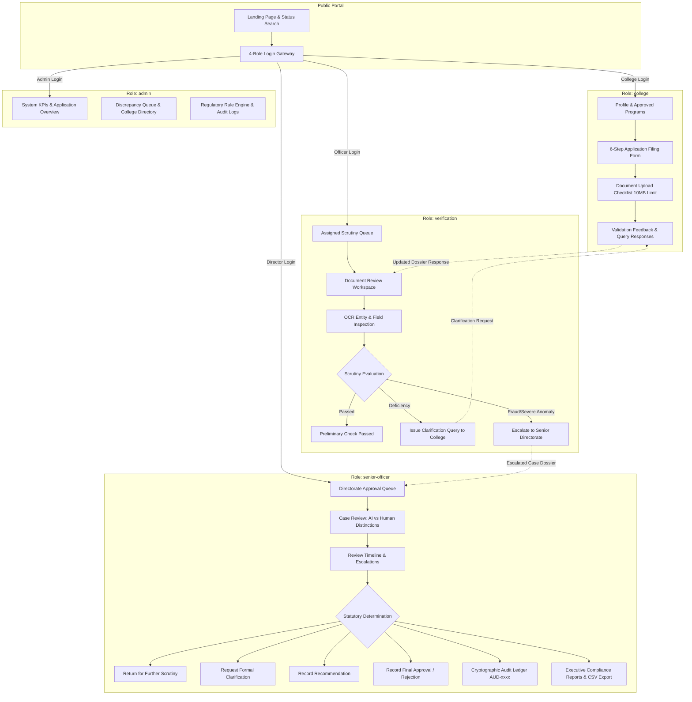

# AICTE Institutional Application Validation, Document Authentication & Regulatory Compliance Verification System
## Master System Blueprint & Architecture "Brain File" (SIH Problem Statement ID: 26261)

---

## 1. Executive Summary & Problem Context

### 1.1 The SIH Problem Statement (ID: 26261)
Every academic year, the **All India Council for Technical Education (AICTE)** processes tens of thousands of institutional applications for:
- **Extension of Approval (EoA)** for existing institutions
- **Establishment of New Technical Institutions**
- **Introduction of New Courses / Emerging Technologies** (e.g., AI/ML, Data Science, Cyber Security)
- **Increase in Approved Intake / Variation in Intake**
- **Closure of Courses / Institutions**

Currently, institutional scrutiny involves manual, labor-intensive review of hundreds of pages of physical and scanned PDF dossiers—including land ownership contiguity deeds, municipal building approvals, structural stability certificates, fire safety NOCs, faculty cadre rosters, and financial balance sheets. 

### 1.2 Core Vulnerabilities in the Current Process
1. **Scrutiny Bottlenecks**: Verification officers spend hundreds of hours manually verifying mathematical figures, land contiguity, and cadre ratios.
2. **Faculty "Ghosting" & Double Employment**: The same faculty member often appears on rosters of multiple colleges concurrently to satisfy Student-to-Faculty Ratios (SFR).
3. **Forged / Outdated Endorsements**: Expired municipal fire NOCs, unverified land title registrations, and fake approvals bypass routine checks.
4. **Lack of Transparent Audit Trails**: Limited immutable tracking of why an application was approved, flagged, queried, or escalated between regional officers and directorates.

### 1.3 The Solution Vision
An automated, assistive, and tamper-evident platform that:
- Ingests institutional applications and uploaded statutory documents.
- Runs **Optical Character Recognition (OCR) + Document Intelligence** to extract structured parameters.
- Executes an **Automated APH Regulatory Rule Engine** to flag discrepancies, ratio failures, and boundary anomalies.
- Detects **Cross-Institutional Faculty & Asset Duplications**.
- Provides **Interactive Role-Based Dashboards** for Colleges, Verification Officers, Regional Directors, and System Administrators.
- Generates an **Immutable Cryptographic Audit Trail** for every statutory decision.

---

## 2. Current Implementation State (Frontend Prototype)

The current codebase is an interactive React 19 + Vite 8.3 application located in [`aicte-validator-frontend/`](./aicte-validator-frontend/). It simulates the complete end-to-end lifecycle of institutional applications using a centralized in-memory and session-synced state engine (`DemoStateContext`).

### 2.1 Tech Stack Implemented
| Layer | Technology | Purpose |
| :--- | :--- | :--- |
| **Framework** | React 19.3 + Vite 8.3 | Ultra-fast client-side rendering and HMR |
| **Styling** | Tailwind CSS v4 | Custom Indian Government Portal Aesthetic (`#102D52` Navy, Emerald, Amber, Slate) |
| **Routing** | React Router DOM v7 | Route grouping, layouts, and protected navigation |
| **Icons** | Lucide React | High-clarity administrative and operational iconography |
| **HTTP Client** | Axios | Configured with base URL and interceptors in `src/services/api.js` |
| **State Engine** | React Context + SessionStorage | Synchronized cross-role prototype state persistence |
| **Linter** | Oxlint | High-performance Rust-based static linting |

---

## 3. System Architecture & Role Flow Diagram



---

## 4. Deep-Dive: The 4 Role Portals & UI Workflows

### 4.1 College Representative Portal (`/college`)
- **Institution Profile**: Shows AISHE code, Permanent Institute ID, affiliation details, land area (7.5 acres), built-up area (14,200 sq.m), and approved program intake.
- **6-Step Application Filing Wizard (`MultiStepApplicationForm.jsx`)**:
  1. *Step 1: Institution Details* (Prefilled from institutional registry).
  2. *Step 2: Application Type* (EoA, New Course, Intake Increase, NRI/OCI quota).
  3. *Step 3: Course & Intake* (Proposed course name, department, proposed seats, market demand justification).
  4. *Step 4: Faculty Cadre* (Total faculty, Professors, Associate Professors, Assistant Professors, cadre ratio compliance declaration).
  5. *Step 5: Infrastructure* (Land area, built-up area, classrooms, labs, Fire NOC registration number, barrier-free ramps/lifts compliance).
  6. *Step 6: Declaration & Submission* (Acceptance of penal clauses under AICTE Act 1987).
- **Document Upload Checklist (`DocumentUploadChecklist.jsx`)**:
  - Enforces PDF, PNG, JPG formats with a strict client-side 10 MB limit.
  - Covers Land Deeds, Approved Building Plans, Fire Safety NOCs, Pollution Clearance, Affiliation Letters, and Faculty Salary Proofs.
- **Assistive Validation Results (`ValidationResultsView.jsx`)**:
  - Displays automated pre-checks (e.g., Land contiguity, Fire NOC validity, Cadre ratio).
  - Emphasizes that automated outputs are **preliminary assistive checks** and not final statutory clearances.
- **Queries & Clarifications (`QueriesClarificationsView.jsx`)**:
  - College reps review scrutiny questions raised by officers and upload rebuttal documents or textual explanations.

### 4.2 Verification Officer Console (`/verification`)
- **Assigned Applications Queue**: Filterable by status (`Under Review`, `Review Required`, `Escalated`, `Scrutiny Passed`) and urgency.
- **Document Review Workspace (`DocumentReviewWorkspace.jsx`)**:
  - Side-by-side view of uploaded institutional files and extracted OCR metadata.
  - Four neutral outcome selections:
    1. `Preliminary Check Passed`
    2. `Missing Information`
    3. `Possible Inconsistency`
    4. `Manual Verification Required`
  - Integrated Scrutiny Officer Notes auto-saving to application state.
- **Clarification Issuance (`ClarificationQueryModal.jsx`)**:
  - Issue formal queries with regulatory category, deadline, and mandatory document requirements.
- **Escalation Trigger (`EscalationModal.jsx`)**:
  - Transfers suspect dossiers directly to the Regional Directorate with evidence summaries (e.g., duplicate faculty profiles).

### 4.3 Senior AICTE Officer / Regional Director Portal (`/senior-officer`)
- **Regional Approval Review Queue**: High-priority dossiers pending directorate sign-off or escalation review.
- **Comprehensive Case Review Workspace (`SeniorCaseReviewWorkspace.jsx`)**:
  - **Explicit visual distinction between Automated AI Extractions and Human Officer Scrutiny Remarks** to maintain accountability.
  - Multi-tab inspection: Dossier Documents, Clarification History, Escalation Evidence, and Audit Timeline.
- **Statutory Decision Modal (`SeniorDecisionModal.jsx`)**:
  - Four formal supervisory workflows:
    1. *Return for Further Review* (Reassigns to officer with re-scrutiny instructions and turnaround SLA).
    2. *Request Additional Clarification* (Direct directorate query to institution).
    3. *Record Recommendation* (Submits case to Regional Scrutiny Board / Executive Council).
    4. *Record Final Decision* (Grants Provisional Approval or Disapproval with statutory conditions).
- **Officer Performance Analytics (`OfficerPerformanceView.jsx`)**:
  - Tracks review throughput, average turnaround days, in-progress scrutiny cases, and escalation rates per officer.
- **Executive Compliance Reports & Dynamic CSV Export (`ComplianceReportsView.jsx`)**:
  - Real-time aggregation of approval rates, regional distribution, and instantaneous CSV generation from active applications.
- **Statutory Audit Ledger (`AuditTrailView.jsx`)**:
  - Chronological, tamper-evident log containing SHA-256 style verification hashes (`AUD-xxxx`) for every institutional action.

### 4.4 System Admin Console (`/admin`)
- Macro-level KPI cards (Total Submissions, Scrutinized, Flagged Documents, Finalized Approvals).
- College Directory & Institutional Management.
- Regulatory Discrepancy Queue & Global Audit Logs.

---

## 5. Master Data Model & Schemas

The frontend currently uses normalized data objects in `src/data/` and `src/context/DemoStateContext.jsx`. The incoming backend must mirror and persist these entities in a relational/document database:

### 5.1 Application Entity Schema
```typescript
interface Application {
  id: string;                     // e.g., "APP-2026-ENG-1042"
  collegeName: string;            // e.g., "Bhartiya Institute of Technology & Science"
  institutionName: string;
  aisheCode: string;              // e.g., "C-49210"
  permanentInstituteId: string;   // e.g., "1-49210492"
  region: string;                 // e.g., "Central Region (Bhopal)"
  state: string;
  district: string;
  applicationType: ApplicationType; // "Extension of Approval (EoA)" | "New Institution" | "New Course" | "Intake Variation"
  academicYear: string;           // "2026-27"
  stream: string;                 // "Engineering & Technology" | "Management" | "Pharmacy"
  currentStatus: ApplicationStatus; 
  // "Draft" | "Under Review" | "Review Required" | "Escalated" | "Scrutiny Passed" | "Approved" | "Rejected"
  statusSeverity: 'info' | 'warning' | 'danger' | 'success';
  priority: 'Normal' | 'High' | 'Critical';
  submissionDate: string;
  deadlineDate?: string;
  daysRemaining?: number;
  assignedOfficer: string;        // Name of assigned scrutiny officer
  verificationOfficer: {
    name: string;
    id: string;                   // e.g., "AICTE-SCR-202"
    desk: string;
  };
  documentsCount: number;
  flaggedCount: number;
  preliminaryOutcome: string;
  reviewNotes: string;
  officerNotes: string;
  escalationReason?: string;
  escalationSummary?: string;
  documents: DocumentRecord[];
  timeline: TimelineEvent[];
}
```

### 5.2 Document Record Schema
```typescript
interface DocumentRecord {
  id: string;                     // e.g., "doc-1"
  title: string;                  // "Land Ownership Title Deed & Contiguity Certificate"
  category: string;               // "Land & Legal" | "Building & Safety" | "Faculty" | "Affiliation"
  status: 'Uploaded' | 'Pending' | 'Flagged' | 'Verified';
  checkStatus: 'Preliminary Check Passed' | 'Review Required' | 'Possible Inconsistency' | 'Missing Information';
  fileName?: string;
  fileSize?: string;
  fileUrl?: string;               // Storage URL (S3 / MinIO)
  uploadedDate?: string;
  extractedFields: Array<{
    label: string;
    value: string;
    confidenceScore?: number;    // e.g., 0.94
    isFlagged?: boolean;
    flagReason?: string;
  }>;
}
```

### 5.3 Clarification Query Schema
```typescript
interface ClarificationQuery {
  id: string;                     // e.g., "CQ-104"
  applicationId: string;
  collegeName: string;
  category: string;               // "Faculty Cadre Deficiency" | "Fire Safety Certificate Renewal" | "Land Contiguity"
  subject: string;
  officer: string;
  dateIssued: string;
  status: 'Pending College Response' | 'Response Submitted' | 'Resolved';
  description: string;
  responseRequired: string;
  collegeResponse?: string;
  submittedAt?: string;
  attachments?: string[];
}
```

### 5.4 Escalation Record Schema
```typescript
interface EscalationRecord {
  id: string;                     // e.g., "ESC-401"
  applicationId: string;
  collegeName: string;
  reason: string;
  evidenceSummary: string;
  recommendedNextStep: string;
  seniorAuthority: string;
  status: 'Escalated to Regional Director' | 'Under Senior Review' | 'Resolved';
  timestamp: string;
}
```

### 5.5 Senior Decision & Audit Trail Schema
```typescript
interface SeniorDecision {
  id: string;                     // e.g., "DEC-2026-105"
  applicationId: string;
  institutionName: string;
  applicationType: string;
  decisionType: 'Final Approval' | 'Provisional Approval' | 'Rejection' | 'Recommendation Recorded';
  outcome: string;
  outcomeSeverity: 'success' | 'danger' | 'warning';
  decisionDate: string;
  seniorOfficer: string;
  rationale: string;
  conditions?: string;
  targetBoardMeeting?: string;
}

interface AuditEvent {
  id: string;                     // e.g., "AUD-9102"
  timestamp: string;
  applicationId: string;
  action: string;                 // e.g., "Final Decision Recorded", "Query Issued", "File Uploaded"
  actor: string;                  // e.g., "Dr. S. K. Roy (AICTE-DIR-303)"
  desk: string;
  hash: string;                   // Cryptographic verification hash (SHA-256)
  details: string;
}
```

---

## 6. AICTE Approval Process Handbook (APH) Regulatory Rule Matrix

The production backend Rule Engine must implement deterministic and AI-evaluated logic matching the AICTE Approval Process Handbook (APH 2026-27):

| Regulatory Area | APH Norm Reference | Rule Logic | Severity on Failure |
| :--- | :--- | :--- | :--- |
| **Land Contiguity** | APH Chapter 1, Clause 1.4 | Land must be a single contiguous piece (Mega/Metro: ≥2.5 acres; Rural: ≥7.5 acres). Division by public roads requires registered underpass/overbridge endorsement. | **CRITICAL (Escalation)** |
| **Built-up Area** | APH Chapter 1, Clause 1.6 | Total Instructional + Administrative + Amenities area must satisfy: `Area >= BaseArea + (Intake * NormFactor)`. | **HIGH (Query to College)** |
| **Student-to-Faculty Ratio (SFR)** | APH Chapter 2, Clause 2.1 | B.Tech/B.E.: Mandatory `1:15` or `1:20` based on accreditation. MBA/MCA: `1:15` or `1:20`. Pharmacy: `1:15`. | **CRITICAL (Intake Reduction)** |
| **Cadre Ratio** | APH Chapter 2, Clause 2.1.4 | Department faculty cadre ratio must adhere to `1 : 2 : 6` (Professor : Associate Professor : Assistant Professor). At least 1 Professor mandatory for department approval. | **HIGH (Clarification Query)** |
| **Faculty Uniqueness** | AICTE Anti-Fraud Directive | PAN, Aadhaar hash, and PFMS salary account must NOT be active concurrently in another institution. | **CRITICAL (Show Cause & Escalation)** |
| **Fire Safety NOC** | APH Annexure 4 | Fire safety certificate must be issued by the competent Civic / District Fire Authority and must be active on the date of scrutiny. | **HIGH (Conditional Hold)** |
| **Barrier-Free Campus** | Rights of Persons with Disabilities Act | Lifts, ramps, and dedicated washrooms must be certified in the architectural layout plan. | **MEDIUM (Review Flag)** |

---

## 7. Blueprint to Make the Product Fully Functional (Backend & AI Architecture)

To transition from the current high-fidelity React frontend prototype into an end-to-end operational government product, the following components must be built:

```text
                               +-----------------------------+
                               | React 19 Frontend (Current) |
                               +--------------+--------------+
                                              |
                                     REST / JSON APIs
                                              |
                               +--------------v--------------+
                               |     API Gateway / Auth      |
                               | (FastAPI / Express + JWT)   |
                               +--------------+--------------+
                                              |
        +-------------------------------------+-------------------------------------+
        |                                     |                                     |
+-------v---------+                  +--------v--------+                   +--------v--------+
|  PostgreSQL DB  |                  | Celery / Redis  |                   | MinIO / S3 Store|
| (Relational     |                  | (Async Document |                   | (Encrypted PDF  |
| Data, Logs)     |                  | Processing Queue|                   |  & Dossier Docs)|
+-----------------+                  +--------+--------+                   +--------+--------+
                                              |                                     |
                             +----------------v-------------------------------------+
                             | Document Intelligence & Rule Engine Worker           |
                             |                                                     |
                             | 1. OCR Preprocessing (PDF page rendering, deskewing)|
                             | 2. Hybrid Extraction (PaddleOCR / Textract / Gemini)|
                             | 3. APH Rule Engine (Python business logic checks)   |
                             | 4. Cross-Institute Faculty Deduplication (Postgres) |
                             | 5. SHA-256 Cryptographic Audit Ledger Generator     |
                             +-----------------------------------------------------+
```

### 7.1 Backend Stack Recommendation
- **Runtime & Framework**: **Python 3.11+ with FastAPI**
  *Why Python?* Direct native integration with computer vision (OpenCV), Sarvam Document AI API (`digitise` & `extract`), document processing (PyMuPDF), and machine learning libraries.
- **Database**: **PostgreSQL 16** with JSONB support and pg_trgm for fuzzy text searching.
- **Object Storage**: **MinIO** or **AWS S3** for secure, versioned, encrypted storage of institutional documents.
- **Asynchronous Task Queue**: **Redis + Celery** or **ARQ** for handling background document processing without blocking user requests.
- **Cache**: **Redis** for session management and rate limiting.

### 7.2 Optical Document Intelligence & OCR Pipeline
1. **Document Ingestion**:
   - Institutional user uploads multi-page PDF or image via `/college`.
   - File is scanned for malware, hashed (SHA-256 for audit integrity), and saved to private object storage.
2. **Page Segmentation & OCR**:
   - Convert PDF pages into 300 DPI images (`pdf2image` / `PyMuPDF`).
   - Run layout analysis using `LayoutLMv3` or `PaddleOCR` to separate document headers, tables, stamp seals, and signatures.
   - Run OCR extraction on text and tabular structures (e.g., faculty rosters, land plot survey numbers, area calculation tables).
3. **Entity Extraction & Semantic Parsing**:
   - Extract key attributes using Regex + Named Entity Recognition (NER) / LLM prompts:
     - `Land Area (Acres / Hectares / Sq.m)`
     - `Survey / Khasra Numbers` & `Contiguity declaration`
     - `Fire NOC Number`, `Issuing Authority`, `Expiry Date`
     - `Faculty Names`, `Designation`, `PAN`, `Aadhaar Hash`, `Appointment Date`
     - `Classrooms count`, `Laboratories count`, `Total Built-up Area`
4. **Confidence Scoring**:
   - Every extracted field is assigned a confidence metric (0.0 to 1.0).
   - Any field below 0.85 is flagged with `Review Required` for human officer verification.

### 7.3 Cross-Institute Deduplication Engine (Ghost Faculty Detector)
- Maintains a centralized hash index of:
  - Masked PAN numbers
  - Salted Aadhaar hashes
  - PFMS/Bank account identifiers
- When an application files a faculty roster in Step 4:
  - The deduplication worker checks if any faculty record exists in another active application for the same academic cycle.
  - If a collision occurs:
    - Automatically marks document check status as `Possible Inconsistency`.
    - Generates an auto-escalation dossier for the Verification Officer and Regional Director (`ESC-xxx`).

### 7.4 Immutable Cryptographic Audit Ledger
- Every critical state transition:
  - Document upload
  - Clarification issued / responded
  - Review outcome recorded
  - Senior approval / rejection
- Is written to an append-only PostgreSQL table `audit_ledger`.
- Each record calculates:
  `Hash = SHA256(PreviousHash + Timestamp + ApplicationID + ActorID + Action + Payload)`
- Ensures that tampering with historic approvals or scrutiny notes invalidates the chain, meeting legal scrutiny standards under the Indian Evidence Act.

---

## 8. Backend API Specification Matrix (For Incoming Developer)

The frontend's [`src/services/api.js`](./aicte-validator-frontend/src/services/api.js) already targets `VITE_API_BASE_URL` (default `http://localhost:8000`). The backend developer should implement the following REST endpoints:

### 8.1 Authentication & Session
- `POST /api/v1/auth/login`: Authenticate with User ID / Email + Password. Returns JWT access token & user profile (roles: `admin`, `college`, `verification`, `senior-officer`).
- `GET /api/v1/auth/me`: Validates active token and returns user details.
- `POST /api/v1/auth/logout`: Invalidates session/refresh token.

### 8.2 Applications Management
- `GET /api/v1/applications`: Query applications with filters (`status`, `region`, `priority`, `academicYear`, `page`, `limit`).
- `GET /api/v1/applications/{appId}`: Complete application bundle (details, documents, timeline, review notes).
- `POST /api/v1/applications`: (College) Create new institutional application (from 6-step form).
- `PATCH /api/v1/applications/{appId}/notes`: (Officer) Update scrutiny examination notes.
- `POST /api/v1/applications/{appId}/complete-review`: (Officer) Submit preliminary review outcome (`Preliminary Check Passed`, `Missing Information`, etc.).

### 8.3 Document Uploads & OCR
- `POST /api/v1/applications/{appId}/documents/upload`: Upload file multipart form. Triggers async OCR extraction pipeline.
- `GET /api/v1/applications/{appId}/documents/{docId}/extracted`: Returns extracted key-value fields and confidence scores.
- `PATCH /api/v1/applications/{appId}/documents/{docId}/override`: (Officer) Manual override of extracted field value.

### 8.4 Clarification Queries
- `GET /api/v1/queries`: List clarification queries (filtered by `applicationId` or `collegeId`).
- `POST /api/v1/queries`: (Officer) Issue formal clarification query.
- `POST /api/v1/queries/{queryId}/respond`: (College) Submit response explanation and optional document attachments.

### 8.5 Escalations & Senior Decisions
- `GET /api/v1/escalations`: List escalated cases awaiting Directorate attention.
- `POST /api/v1/escalations`: (Officer) Escalate an application with evidence summary.
- `POST /api/v1/senior-officer/decisions`: (Director) Record statutory decision:
  - `actionType`: `return_review` | `request_clarification` | `recommendation` | `final_decision`
- `GET /api/v1/senior-officer/history`: Retrieve decision history log.

### 8.6 Audit Trail & Compliance Reports
- `GET /api/v1/audit/trail`: Retrieve chronological audit ledger records with verification hashes.
- `GET /api/v1/reports/compliance`: Aggregated metrics for approvals, deficiencies, and regional breakdown.
- `GET /api/v1/reports/export-csv`: Stream dynamic CSV of filtered institutional applications.
- `GET /api/v1/reports/officer-performance`: Operational scrutiny metrics (assigned, completed, average SLA days).

---

## 9. Handoff Checklist for New Teammates / Next Steps

When passing this repository to another developer, instruct them to follow this exact sequence:

1. **Clone & Run Frontend**:
   ```bash
   cd aicte-validator-frontend
   npm install
   npm run dev
   ```
   Explore all 4 roles from the Login Gateway at `http://localhost:5173/login`.

2. **Backend Setup**:
   - Create a Python virtual environment in a new directory (e.g. `aicte-validator-backend/`).
   - Install FastAPI, Uvicorn, SQLAlchemy, Pydantic, Alembic, psycopg2.
   - Implement the database schemas outlined in **Section 5**.
   - Implement the REST endpoints specified in **Section 8**.

3. **OCR & Rule Engine Worker**:
   - Build a lightweight worker script using `PyMuPDF` and `Sarvam Document AI API` (`digitise` & `extract`) to parse uploaded PDFs.
   - Implement the rule verification logic detailed in **Section 6**.

4. **Integration**:
   - Update `aicte-validator-frontend/.env`:
     ```env
     VITE_API_BASE_URL=http://localhost:8000
     ```
   - Swap `DemoStateContext.jsx` calls with live Axios API calls to `src/services/api.js`.

---

*Document compiled for Smart India Hackathon (SIH Problem Statement ID: 26261) technical handoff.*
